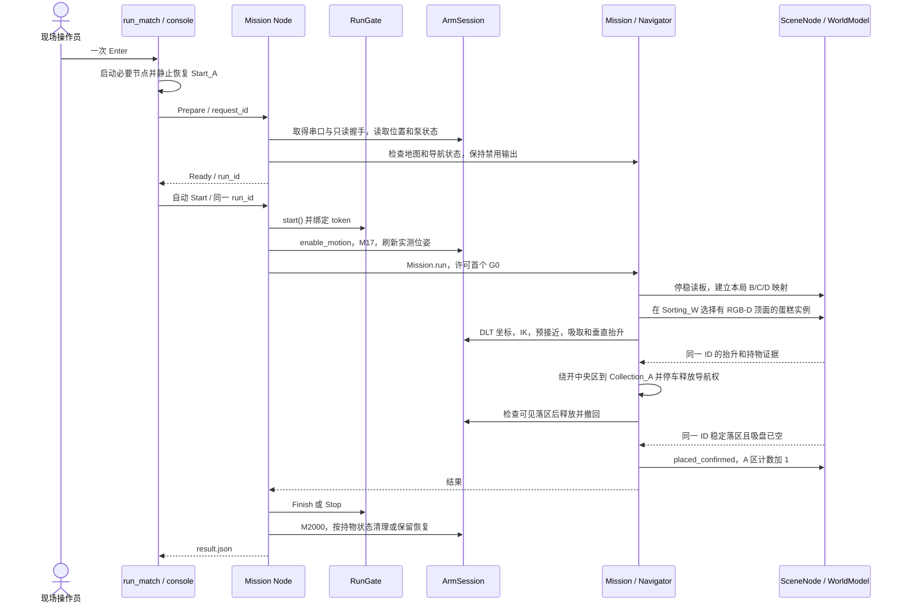

# Spark-I Cake-only 集成与部署

唯一发布分支为 `codex1/integrated-mission-navigation`。部署版本取包含本说明及 [部署文件清单](cake-only-deployment.json) 的提交。配置为 ROS 1 Noetic、`cake-only`、`slow`、`rollout`、DLT 和原路线西侧取物。真机部署、catkin 构建和动作验收均为 **NOT TESTED**。

## 合并记录

共同基线为 `bea74527ed8ba0bb5c045f99c5de63e86dec423e`。双亲合并的第一父提交是 Codex2 `e251c73`，第二父提交是 Codex1 `b452358`。随后提交集中修正跨模块交接和 Cake-only 资源选择。两个原分支及 `dev/branch-2` 保留各自历史。

| 文件 | Codex1 启动权限 | Codex2 导航 | 集成后的行为 |
| --- | --- | --- | --- |
| `automation/mission_node.py` | Prepare 只读、单 worker、Start 绑定 token、串口写入与 Stop 互斥、明确恢复 | `_navigate` 使用分段预算，保留重规划和结果记录 | 已停车且目的站、run ID、持物 ID 都吻合才允许放置。源时间戳、标定版本或场景不匹配时拒绝。释放后证据不足也保留恢复状态。 |
| `automation/serial_mission.py` | 只读握手后的 `M17` 延至 Start，随后重读机械臂位置 | 通过 `mission_stations` 解析正式站点并验证地图 | 保留两侧改动。释放前检查落区资源和支撑面，落区内稳定顶面及吸盘已空两项证据才确认放置。 |
| `automation/mission.py` | 相对于共同基线无修改 | 同一 action ledger、导航预算及读板站轮换 | 通过原 Navigator 执行。四侧取物候选一次遍历共享原截止时间。持物未知中止流程，只有 `PLACED_CONFIRMED` 才更新已交付数。 |

`run_gate.py`、`arm_session.py` 保留首阶段权限修复。入口用 Linux `flock` 串行启动，ROS 上已有 Ready、运行中、待恢复或状态不明的任务时拒绝替换。导航仍由 `/suat_mission` 通过导航门控取得唯一底盘控制权。离墙、巡航、末段对准各有预算与停车释放余量，切站受原限时约束。4.2 版 OpenCV 的轮廓输入明确使用连续内存，保留原视觉几何与检测。代码差异可复查。

```bash
git diff bea7452..b452358 -- src/suat_mission/src/suat_mission/automation/
git diff bea7452..e251c73 -- src/suat_mission/src/suat_mission/automation/
git log --graph --oneline -8
git diff --name-status e251c73..HEAD
```

## 一次 Enter 的执行链



Stop 立即撤销普通动作许可、取消导航并保留 `M2000`。持物状态未知时保持吸泵状态并锁住普通任务。显式恢复完成后才允许 Reset。关闭准备或失败会话不会自动重启会发送 `M17` 的原厂串口节点。

## 本地资源核对与离线规划

以 Windows 上已保存的 `D:\Mrobot` 副本为输入，使用发布分支的资源解析器检查。生成现场任务时，SceneNode 和 Mission 通过同一个 `geometry_file` 加载 `field_20261119_visual_dlt_candidate`，从 `/suat/perception/grasp_instances` 接收独立场景。原 DLT 标定下 `arm_yaw_in_base_rad` 未测，默认配置禁用取物时底盘微调。软件链仍支持在显式齐备的配置下执行有界校验和微调。正式读板使用真实彩色图逐帧投票，地码为辅助方向证据。

| 语义站 | 本地资源的位姿 x、y、yaw | 实际选点行为 |
| --- | --- | --- |
| Start_A | 0.1007, −0.0663, 0.5771 | `start_pose_A.yaml`，静止定位后按实际足迹离墙 |
| Classification_area | 0.9843, 1.0338, −1.0179 | 原目标未通过 0.25 m 静态净空筛选。已配置的 `latest_recording` 与 `latest_backoff_5cm` 可进入运行时验证。 |
| Sorting_W | 0.7387, 1.3617, 2.2111 | 原路线西侧取物站 |
| Collection_A | 0.2599, 0.3729, −1.5401 | 原路线 A 放置站 |

选图为 `corner_20261115_A_03`，地图记录身份仍用采集时的 `UNALIGNED`，选图另有 `corner_lidar_20261120_A_03` 的 field→map 文件。两者各用于原始 map 坐标校验和场地转换。未重新测量现场精度。半径采用现有配置 0.22 m，站点净空检查采用现有 0.25 m。中央禁行区域保留。

本地静态规划检查了 A 起点到两个可用读板候选、两个读板候选到西侧、西侧到放置点，共 5 条。A 段需离墙，其余有静态路径。西侧到放置点长约 1.10 m。新录四侧点和 39 × 39 cm 候选留在专项配置和覆盖工具中。导航或相机视野是否达到实际操作要求仍需现场验证。

## 构建、部署和依赖

在有 ROS Noetic 的 Ubuntu 20.04 主机使用 Python 3.8 与 catkin。ROS 包完整清单见 [package.xml](../src/suat_mission/package.xml)。重点包括 Spark-I 的 `spark_bringup`、`spark_base`、`spark_description`、`spark_navigation`、`ydlidar_g2`、`swiftpro`，RealSense 的 `realsense2_camera` 和相应驱动，`map_server`、`amcl`、TF2、`move_base`、`global_planner`、`navfn`、`dwa_local_planner`、`costmap_2d`、`nodelet`、`follower_velocity_smoother`。运行需要 ROS 消息、`cv_bridge`、`message_filters`、NumPy、PyYAML 和 OpenCV；RViz 及有显示权限的桌面会话用于观测。系统工具需要 Bash、`util-linux` 提供的 `flock`、`psmisc` 提供的 `fuser` 及可打开实际 SwiftPro 串口的用户权限。原厂工作空间保持 `/home/spark/spark_noetic`。

执行端先把发布提交检出到独立构建目录，再核对与主入口的差异。

```bash
git fetch origin codex1/integrated-mission-navigation
git worktree add --detach /home/spark/SUAT/spark-cake-build FETCH_HEAD
cd /home/spark/SUAT/spark-cake-build
source /opt/ros/noetic/setup.bash
source /home/spark/spark_noetic/devel/setup.bash
catkin_make
source devel/setup.bash
rospack find suat_mission
python3 tools/check_readiness.py --workspace-root /home/spark/SUAT/spark
python3 -m unittest discover -s tests -v
```

主入口若含现场未提交代码，按 [清单](cake-only-deployment.json) 对三方差异进行核对和合并，保留现有导航、视觉现场改动与所有资源。只在已经是 `e251c73` 的代码上才适用清单中的增量覆盖。若代码基线不同，先核对完整发布模块。主入口完成合入后在该目录重新构建，并核对 `rospack find suat_mission` 指向主入口源码。台账保存实际部署 commit、现场原版本和回退点。

## 测试记录

在 Windows 使用 Python 3.12.14、NumPy 2.3.5、PyYAML 6.0.3。下列命令只读取本地资源或运行 Mock。

```text
python -m unittest discover -s tests -v
python tools/check_readiness.py --workspace-root D:/Mrobot
python tools/prepare_field_route.py --workspace-root D:/Mrobot --coverage --mission-config src/suat_mission/config/mission.yaml
python tools/run_competition.py --help
bash -n tools/run_match.sh
```

- **Mock 28 项通过**。15 项正式启动权限和回滚，5 项现有导航预算、候选绑定和绕行，8 项使用同一个正式 ROS 任务适配器串起读板、目标、抓放与结束。相机帧、模板输出、AR 解码、导航输出和 SwiftPro 回应来自测试替身。新增场景覆盖同 ID 完成、候选共享时间、标定和时间戳拒绝、错误地图、缺顶面深度、持物未知、运输中 Stop、落区不符及缺少脱离证据。成功用例也验证 M17 后读取位置且在首个 G0 前。
- **本地资源与静态规划通过**。资源读取没有配置错误，离线路径结果见上表。模板、地码图和场地变换输入在本地副本存在。
- **兼容性静态检查通过**。Python 用 3.8 语法解析，ROS 启动 XML 和 catkin 已注册入口检查。实际 Ubuntu Python 3.8、ROS Noetic、catkin、硬件串口和相机版本组合为 **NOT TESTED**。

## C0–C11 现场验收

现场先准备 A 红区、朝 D、中心蛋糕按规则叠放、读板可见。从机器人桌面运行以下唯一入口，出现提示后按一次 Enter。后续由程序连续执行。

```bash
cd /home/spark/SUAT/spark
bash tools/run_match.sh cake-only --at-start-a --speed slow --planner rollout
```

| 检查 | 现场证据 | 当前证据与状态 |
| --- | --- | --- |
| C0 发布与构建 | 对应 commit、catkin 返回码、正确 ROS 叠层、四站和选图一致 | 资源检查通过，真机构建 **NOT TESTED** |
| C1 单入口启动 | 一次 Enter，唯一任务 worker，RGB-D、导航、观测窗口日志 | 静态和 Mock，真机 **NOT TESTED** |
| C2 原点静止对齐 | `start_localization.json`、围挡和分类台方位对应、底盘未先行运动 | 本地资源检查，真机 **NOT TESTED** |
| C3 Prepare/Start | Prepare 无 `M17/G0/M2231`，运行 token 内先 `M17` 再位置反馈和首个 `G0` | Mock，真机 **NOT TESTED** |
| C4 A 离墙与到读板站 | 实际离墙，报告到站误差、停车和控制权释放 | 静态及既有导航 Mock，真机 **NOT TESTED** |
| C5 正式读板 | 同 run 的三类与 B/C/D 映射、方向来源、原图和票数 | BoardReader 联调 Mock，真机 **NOT TESTED** |
| C6 西侧停稳与定位蛋糕 | `Sorting_W`、同一实例 ID、当前标定、顶面几何与 IK | 静态及 Mock，真机 **NOT TESTED** |
| C7 吸取和持物 | 可见吸盘贴合、垂直抬离、同一实例随吸盘、运输姿态 | Mock，真机 **NOT TESTED** |
| C8 带载绕行和到 A | 轨迹绕过中央禁区，持物证据持续，到 `Collection_A` 停稳 | 静态及 Mock，真机 **NOT TESTED** |
| C9 释放与落区 | A 红区实物稳定，视觉证明脱离且物块在落区内 | Mock，真机 **NOT TESTED** |
| C10 计数与结束 | 同一 run 的 `execution=completed`、`delivered_confirmed.cake=1`、其他三类为 0、单条 A 区放置确认 | Mock，真机 **NOT TESTED** |
| C11 停止和恢复 | 专项验证等待/运输时 Stop，`M2000`、底盘控制权释放及恢复行为 | Mock，真机 **NOT TESTED** |

保留启动目录的 `resource_selection.json`、`start_localization.json`，以及正式 run 的 `result.json`、`manipulation/events.json`、读板图和导航结果。成功记录需用同一 run ID 检查阶段与计数。失败记录保留首错和实际是否持物。现场风险集中在 A 起点贴墙离墙、读板裁切、西侧实体间距和吸盘视线、A 落区的可见独立证据。当前默认不自动微调底盘，若西侧旧录点达不到机械臂可达范围，流程会给出具体失败并停止。先使用同一套现场资源和正式日志复盘该阶段。
